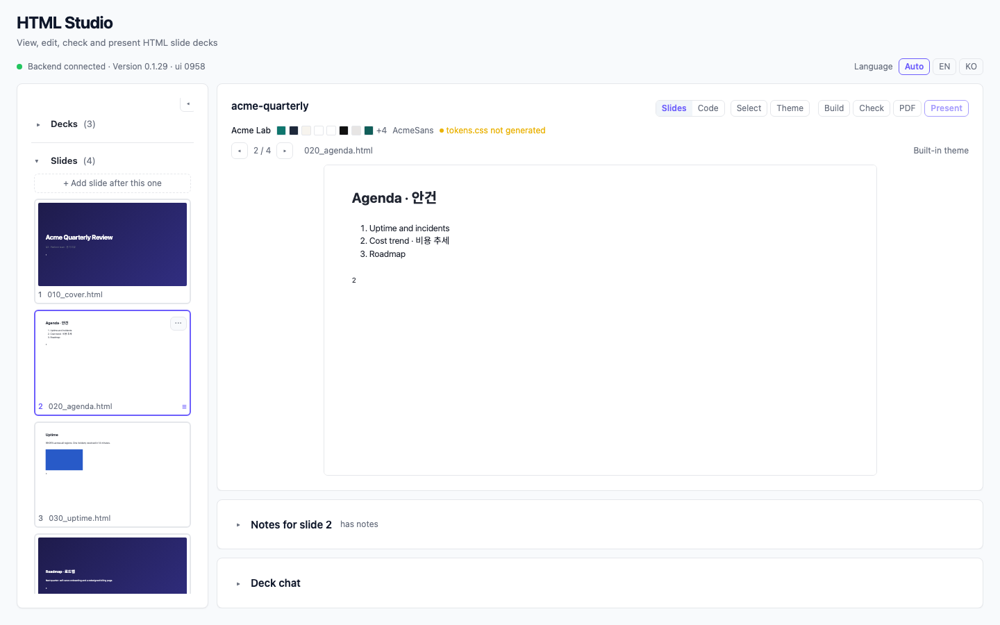
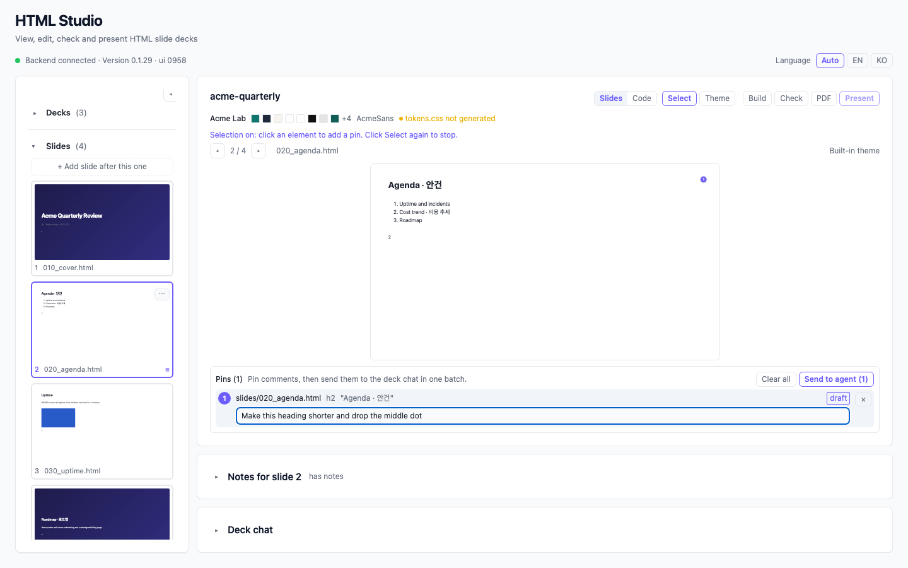
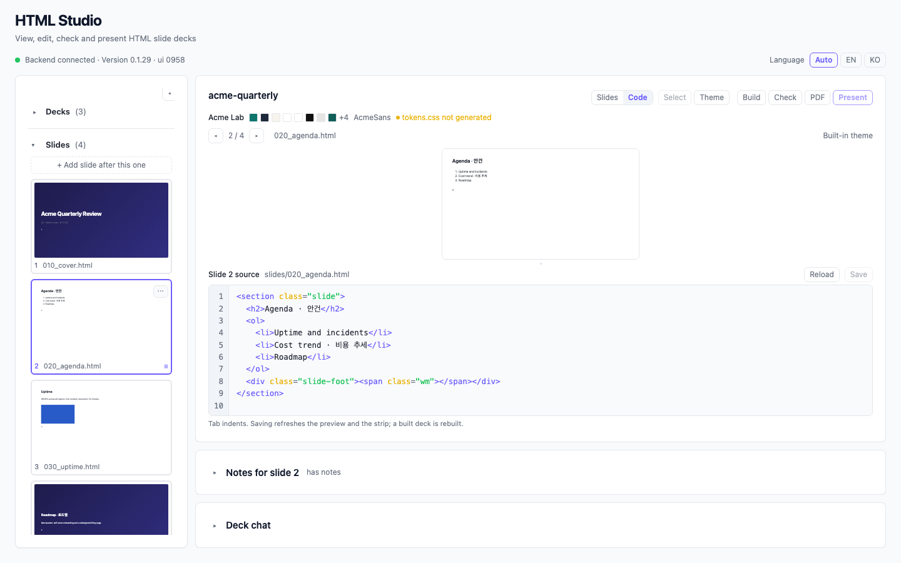
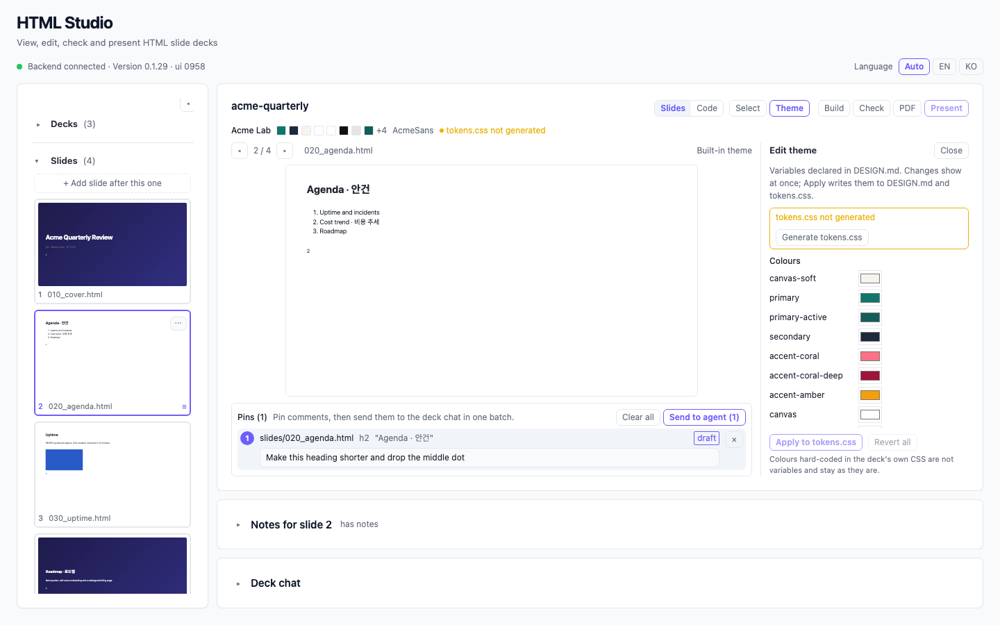
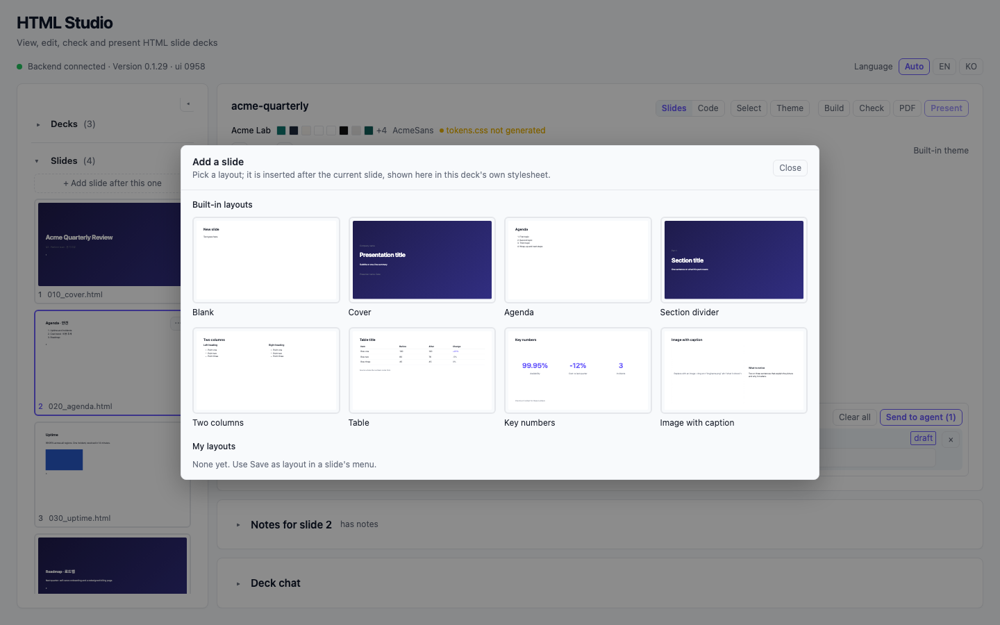
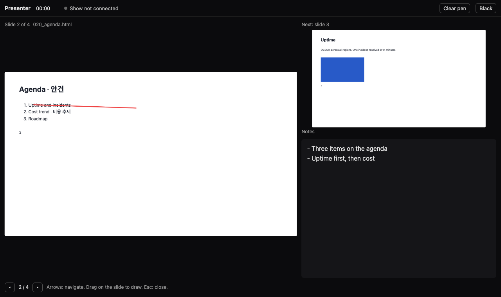

# HTML Studio

HTML 슬라이드 덱을 보고, 고치고, 점검하고, 발표하는 [Kiro Crew](https://kiro.dev) 앱입니다. 덱을 만드는 에이전트와 같은 폴더에서 나란히 일합니다.



HTML 덱은 에이전트가 쓰기는 쉽지만 사람이 조종하기는 어렵습니다. "비용 슬라이드의 세 번째 항목"을 말로 설명하게 되기 때문입니다. HTML Studio는 덱에 작업대를 붙여 줍니다. 렌더된 슬라이드를 보면서 바꿀 곳을 가리키고, 직접 고칠 수 있는 것은 손으로 고치고, 덱 전체를 점검하고, 발표합니다. 에이전트는 같은 폴더에서 계속 일합니다.

## 할 수 있는 것

**보기**
- 등록한 폴더 아래의 덱을 찾습니다. `slides/` 폴더(파일 하나가 슬라이드 하나, 파일 이름 순)가 있는 폴더, 또는 `<section class="slide">` 블록이 여러 개인 `index.html` 하나.
- 모든 슬라이드를 1280x720 스테이지에 라이브로 미리 보고, 스트립에 썸네일을, 빌드 결과가 있으면 그것도 봅니다.
- 폴더를 따라갑니다. 에이전트가 추가하거나 고친 슬라이드는 몇 초 안에 나타납니다.

**에이전트 조종**
- **선택해서 고치기**: 미리보기에서 요소를 클릭하고 바꿀 내용을 적은 뒤, 핀을 한 번에 덱 채팅으로 보냅니다. 에이전트는 파일, 선택자, 텍스트, 코멘트를 받고 핀마다 결과를 보고합니다.
- **빠른 요청**: 현재 슬라이드에 대한 한 번 클릭 프롬프트(글 줄이기, 다음 슬라이드 초안, 노트 작성).
- **덱 채팅**: 덱 폴더에 묶인 채팅 세션. 덱의 구조, 스타일시트, 빌드, 규약을 처음 한 번 브리핑합니다.



**직접 고치기**
- **코드 보기**: 미리보기 아래에 현재 슬라이드의 HTML을 구문 색상과 함께 표시. 저장하면 파일에 쓰고 빌드된 덱은 다시 빌드합니다. 그 사이 다른 곳에서 바뀐 파일은 덮어쓰지 않고 알려 줍니다.
- **배치**: 썸네일을 끌어 순서를 바꾸고, 레이아웃 라이브러리(커버, 아젠다, 구분, 2단, 표, 핵심 숫자, 이미지와 설명, 그리고 직접 저장한 레이아웃)에서 추가하고, 복제하고, 보관(삭제하지 않음)하고 복원합니다. 옮긴 파일만 이름이 바뀝니다.
- **테마**: 덱의 디자인 변수를 실시간 미리보기로 고친 뒤 `DESIGN.md`와 `tokens.css`에 되돌려 씁니다.
- **새 덱**: 짧은 마법사(제목, 발표자, 목적, 청중, 자료, 테마)가 폴더, 커버와 아젠다, `brief.md`를 만들고 에이전트에게 개요를 요청합니다.





**점검과 발표**
- **점검**: 모든 슬라이드를 헤드리스로 렌더해 넘침, 잘림이나 겹침, 깨진 이미지, 낮은 대비, 금지 문장부호, 외부 리소스, 인라인 글자 크기, 커버 누락을 보고합니다. 이슈는 핀으로 바꿀 수 있습니다.
- **발표**: 앱 안 전체화면 쇼와 브라우저의 발표자 창(현재와 다음 슬라이드, 발표자 노트, 타이머, 쇼 위에 그리는 펜, 블랙아웃). 둘은 로컬 미리보기 서버를 통해 동기화됩니다.
- **PDF**: 슬라이드마다 한 페이지, 덱의 인쇄 스타일 사용.



## 덱 규약

HTML Studio는 덱에 프레임워크를 얹지 않습니다. 선택적인 파일 몇 개를 읽고, 요청한 것만 씁니다. 전체 계약은 [docs/deck-format.md](docs/deck-format.md)(영문)에 있고, 요약은 다음과 같습니다.

| 파일 | 용도 |
|---|---|
| `slides/NNN_name.html` | 슬라이드 하나에 파일 하나, `<section class="slide">…</section>`, 이름 순 |
| `index.html` | 또는 슬라이드 섹션 여러 개가 든 파일 하나 |
| `studio.json` | 선택: `slidesDir`, `css`, `build`, `output`, 끌 점검 규칙, 덱 메타데이터 |
| `DESIGN.md` | [DESIGN.md](https://github.com/VoltAgent/awesome-design-md) 형식의 테마. `tokens.css`는 여기서 생성 |
| `notes/<slide>.md` | 발표자 노트. 슬라이드 HTML 안에는 절대 넣지 않음 |
| `archive/` | 덱에서 빼낸 슬라이드(복원 가능) |
| `brief.md` | 덱의 목적(새 덱 마법사가 쓰고 에이전트가 읽음) |

슬라이드는 1280x720 스테이지입니다. 슬라이드 본문에는 엠/엔 대시와 가운뎃점을 쓰지 않습니다(점검이 잡아냄). 제목 위의 라벨 줄은 괜찮습니다.

## 설치

HTML Studio는 Kiro Crew 앱입니다. 체크아웃에서:

```bash
cd ui && npm install && npm run build      # ui/dist/index.mjs 생성
kirocrew app install /path/to/html-studio
kirocrew app enable html-studio
```

대시보드 사이드바에서 **HTML Studio**를 열고, 덱이 든 폴더를 추가한 뒤 하나를 고릅니다. 백엔드는 대시보드가 시작하는 Python 3.11+ 표준 라이브러리 서버이고, 점검과 PDF에는 Chromium 계열 브라우저가 필요합니다(자동으로 찾음).

## 개발

```bash
./verify.sh quick   # 백엔드 단위 테스트, 타입 검사, UI 빌드, 호스트 클래스와 문구 린트
./verify.sh         # ...에 더해 종단 하네스(헤드리스 Chromium)
```

구성과 규약은 [CONTRIBUTING.md](CONTRIBUTING.md)(영문)를 참고하세요.

## 라이선스

MIT. 포함된 글꼴과 아이콘은 [ATTRIBUTION.md](ATTRIBUTION.md)에 있습니다.
