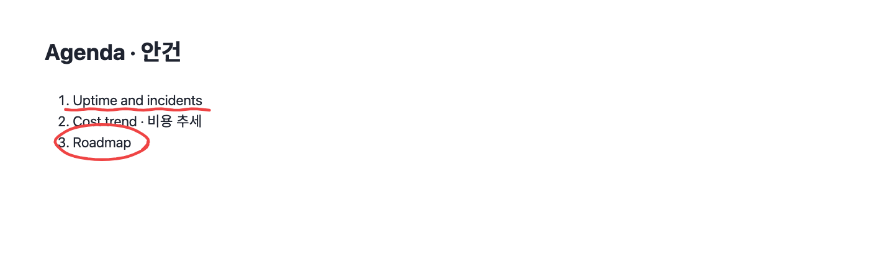

# HTML Studio

A [Kiro Crew](https://kiro.dev) app for viewing, editing, checking and presenting HTML slide decks, side by side with the agent that writes them.


HTML decks are easy for an agent to write and hard for a person to steer: you end up describing "the third bullet on the cost slide" in prose. HTML Studio gives the deck a workbench. You look at the rendered slides, point at what should change, edit what you can by hand, check the whole deck, and present it, while the agent works in the same folder.

## What it does

**See**
- Finds decks under the folders you register (and keeps looking: a deck created elsewhere shows up on its own): a folder with `slides/` (one HTML section per file, ordered by file name) or a single `index.html` with `<section class="slide">` blocks.
- Live preview of every slide on a 1280x720 stage, thumbnails in a strip, the built output when there is one.
- Keeps up with the folder: slides the agent adds or edits appear within a few seconds.

**Steer the agent**
- **Select to edit**: click an element in the preview, write what should change, send the pins to the deck's chat session in one batch. The agent gets file, selector, text and your comment, and reports back per pin.
- **Quick requests**: one-click prompts for the current slide (tighten text, draft the next slide, write notes).
- **Deck chat**: a chat session bound to the deck folder, briefed once on the deck's layout, stylesheet, build and conventions.


**Edit by hand**
- **Code view**: the current slide's HTML with syntax colouring under the preview; Save writes the file and rebuilds a built deck. Edits made elsewhere in the meantime are detected, not overwritten.
- **Arrange**: drag thumbnails to reorder, add from a layout library (cover, agenda, divider, two columns, table, key numbers, image with caption, or your own saved layouts), duplicate, archive (never delete) and restore. Only moved files are renamed.
- **Theme**: edit the deck's design variables with live preview, then write them back to `DESIGN.md` and `tokens.css`.
- **New deck**: a short wizard (title, presenter, purpose, audience, sources, theme) creates the folder, a cover and agenda, a `brief.md`, and asks the agent for an outline.


**Check and present**
- **Check**: renders every slide headless and reports overflow, clipped or overlapping content, broken images, low contrast, forbidden punctuation, external resources, inline font sizes and a missing cover. Each issue can become a pin.
- **Present**: a fullscreen show inside the app plus a presenter window in your browser (current and next slide, speaker notes, timer, pen that draws on the show, blackout). The two stay in sync through the local preview server. The show is assembled live from the slide files, so it always matches what you see in the viewer and needs no build.
- **Build**: assembles the slides into one `out/index.html` for sharing, or runs the deck's own build command after you approve it once (a `build.sh` or `rebuild.sh` found in the deck is offered). A deck built by its own command presents that output, and the studio says when the output is older than the slides.
- **PDF**: every slide as a page, using the deck's own print styles.




## Deck conventions

HTML Studio adds no framework to your deck. It reads a few optional files and writes only what you ask it to. The full contract is in [docs/deck-format.md](docs/deck-format.md); in short:

| File | Purpose |
|---|---|
| `slides/NNN_name.html` | one slide per file, `<section class="slide">…</section>`, ordered by name |
| `index.html` | alternatively, one file with several slide sections |
| `studio.json` | optional: `slidesDir`, `css`, `build`, `output`, check rules to disable, deck metadata |
| `DESIGN.md` | the theme, in the [DESIGN.md](https://github.com/VoltAgent/awesome-design-md) format; `tokens.css` is generated from it |
| `notes/<slide>.md` | speaker notes, never inside the slide HTML |
| `archive/` | slides taken out of the deck (restorable) |
| `brief.md` | what the deck is for (written by the new deck wizard, read by the agent) |

Slides are a 1280x720 stage. Slide text avoids em/en dashes and middle dots (the check flags them); labels above headings are fine.

## Install

HTML Studio is a Kiro Crew app. From a checkout:

```bash
cd ui && npm install && npm run build      # produces ui/dist/index.mjs
kirocrew app install /path/to/html-studio
kirocrew app enable html-studio
```

Then open **HTML Studio** in the dashboard sidebar, register a folder that contains decks (new decks are created inside a registered folder too), and pick one. The backend is a standard-library Python server (3.9 or newer) started by the dashboard; a Chromium-based browser is needed for Check and PDF (found automatically).

## Development

```bash
./verify.sh quick   # backend unit tests, typecheck, UI build, host-class and copy lints
./verify.sh         # ...plus the end-to-end harness (headless Chromium)
```

- `backend/` is standard-library Python, one module per feature, tested with `unittest`.
- `ui/` is React + TypeScript built with Vite. The dashboard provides `react`, `lucide-react` and `@kirocrew/app-sdk` at runtime (marked external in `ui/vite.config.ts`), and its precompiled Tailwind sheet: `e2e/check-classes.mjs` fails the build on a class that sheet does not ship.
- `e2e/` runs the built UI against the real backend inside a harness that stands in for the dashboard (SDK shim, signed proxy, fake chat API), on the fictional decks in `e2e/fixtures/`. First run: `cd e2e && npm install && npx playwright install chromium`.
- `skills/deck-visual-edit/` is the skill the agent reads before handling a batch of pins.

See [CONTRIBUTING.md](CONTRIBUTING.md) for conventions. Korean documentation: [README.ko.md](README.ko.md).

## License

MIT. Bundled fonts and icons are listed in [ATTRIBUTION.md](ATTRIBUTION.md).
